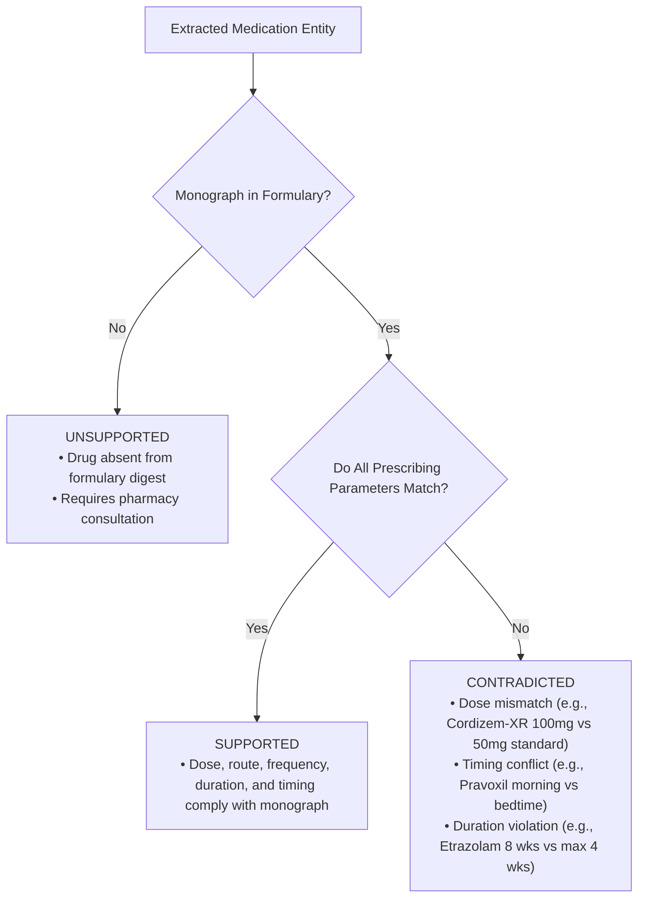
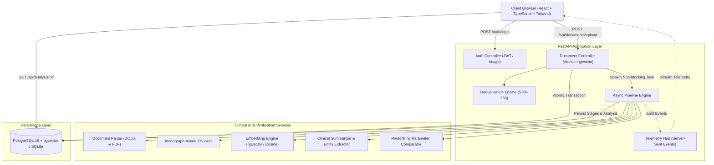
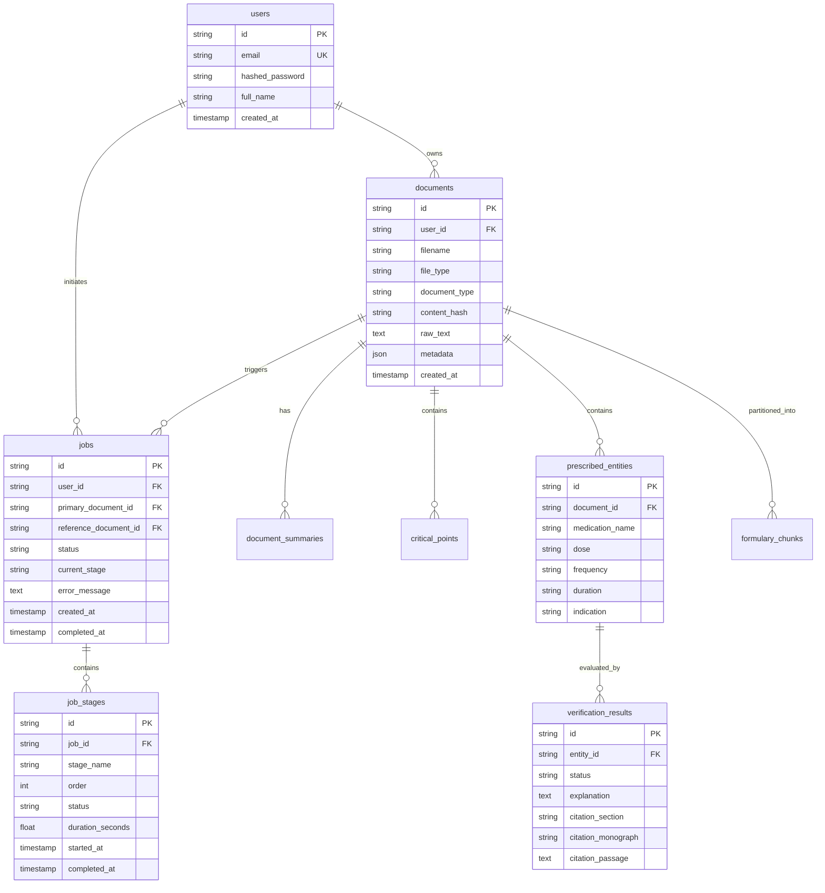

# Meridian Bay Medical Center — Clinical Document Verification System

[](https://www.python.org/downloads/)
[](https://fastapi.tiangolo.com/)
[](https://reactjs.org/)
[](https://github.com/pgvector/pgvector)
[-brightgreen.svg)]()
[](LICENSE)

An asynchronous, event-driven clinical document verification system engineered to ingest inpatient hospital discharge summaries (primary documents), synthesize clinical discharge narratives, surface ranked patient safety-critical action points, extract structured prescription regimens, and verify each prescribed medication against an institutional formulary digest (reference document) using Retrieval-Augmented Generation (RAG) and targeted prescribing parameter comparison.

---

## 1. Quickstart for Assignment Reviewers (Under 3 Minutes)

The repository comes pre-configured with default reviewer credentials and pre-indexed institutional formulary documents so you can immediately test the complete pipeline.

### Pre-configured Reviewer Credentials

| Parameter | Value |
| :--- | :--- |
| **Portal URL** | [http://localhost:8000](http://localhost:8000) |
| **Email** | `reviewer@meridianbay.org` |
| **Password** | `ReviewerPassword123!` |
| **One-Click Autofill** | Click the **"Autofill"** button on the login screen |

---

## 2. Running the Application

### Option A: Standard Local Setup (Fastest)

#### Prerequisites
- Python 3.13+ installed
- Virtual environment (`venv` or `uv`)

```bash
# 1. Clone the repository
git clone <repo_url>
cd documement-verification-agent

# 2. Activate virtual environment
# Windows PowerShell:
.venv\Scripts\activate.ps1
# Or Windows CMD:
call .venv\Scripts\activate.bat
# Linux / macOS:
source .venv/bin/activate

# 3. Install dependencies from requirements.txt
pip install -r requirements.txt

# 4. Start the application (Backend + Frontend served together)
python main.py
```
Open **[http://localhost:8000](http://localhost:8000)** in your browser.

---

### Option B: Docker Compose (Full Stack with PostgreSQL + pgvector)

```bash
# Start PostgreSQL (pgvector) and FastAPI application
docker compose up --build
```
Open **[http://localhost:8000](http://localhost:8000)** in your browser.

---

## 3. Core Workflow Walkthrough

1. **Sign In**: Navigate to `http://localhost:8000`, click **"Autofill"** (or enter `reviewer@meridianbay.org` / `ReviewerPassword123!`), and click **"Sign In"**.
2. **Upload Primary Document**: Click **"Upload Discharge Summary"**, select `data/source_documents/primary_document_medical.docx` (or your own PDF/DOCX discharge summary), and submit.
3. **Real-time Pipeline Telemetry**: Observe the 7 granular pipeline stages transition in real time with active durations and checkmarks:
   $$\text{parsed} \longrightarrow \text{chunked} \longrightarrow \text{embedded} \longrightarrow \text{summarized} \longrightarrow \text{key\_points\_extracted} \longrightarrow \text{entities\_extracted} \longrightarrow \text{verified} \longrightarrow \text{done}$$
   *(Note: Refreshing the page mid-processing seamlessly preserves tracking state via Server-Sent Events).*
4. **Side-by-Side Dual-Pane Workspace**:
   - **Left Pane**: Primary discharge summary rendered with patient demographics (Daniel Okonkwo, MRN MBMC-7714209), hospital course, diagnoses, and prescription table.
   - **Right Pane**: Tabbed analysis workbench:
     - **Formulary Verification**: Filterable medication cards showing verification status (`Supported`, `Contradicted`, `Unsupported`), prescribing parameter comparison tables, and clickable citations.
     - **Critical Action Points**: Ranked patient safety items (urgent adverse effects, abrupt cessation warnings, timing, lab follow-up).
     - **Executive Summary**: Faithful clinical overview synthesizing admission history, hospital course, and discharge stabilization.
     - **Formulary Inspector**: Rendered reference formulary digest.
5. **Inspect Citations**: Click **"Inspect Citation"** on any flagged medication to open the verbatim authoritative passage modal.
6. **Deep-Link into Reference Document**: Click **"View in Reference"** on any flagged medication card. The UI switches to the Formulary Inspector tab, smooth-scrolls to the target monograph, and pulses with a golden highlight!

---

## 4. Formulary Ground Truth & Verification Logic

The institutional formulary digest (`reference_document_medical.docx`, Revision 8.2) is the authoritative source of truth. The system evaluates prescribed parameters against monograph parameters to assign one of three explicit states:



### Verified Regimen Matrix (Test Document Ground Truth)

| Medication | Prescribed Regimen in Primary Document | Formulary Monograph Specification | Outcome | Parameter Discordance | Citation Passage |
| :--- | :--- | :--- | :--- | :--- | :--- |
| **Velantine** | 10 mg PO once daily, indefinitely (Hypertension) | Standard adult dose: 10 mg PO once daily. First-line antihypertensive. Max 40 mg. | **Supported** | Dose, frequency, route, and indication match standard. | *Section I. Cardiovascular Agents — Velantine* |
| **Cordizem-XR** | 100 mg PO once daily, indefinitely (Rate control) | Standard adult dose: 50 mg PO daily, morning. Titrate by 25 mg every 2+ weeks. Max 200 mg. | **Contradicted** | Prescribed initial dose (100 mg) exceeds standard starting dose (50 mg). | *Section I. Cardiovascular Agents — Cordizem-XR* |
| **Pravoxil** | 20 mg PO every morning, indefinitely (Hyperlipidemia) | Standard adult dose: 20 mg PO daily, **at bedtime**. Morning administration substantially reduces therapeutic effect. | **Contradicted** | Chronopharmacological violation: prescribed morning instead of mandatory bedtime. | *Section II. Lipid-Lowering Agents — Pravoxil* |
| **Etrazolam** | 0.5 mg PO twice daily for 8 weeks (Acute anxiety) | Standard dose: 0.5 mg PO twice daily. **Short-term use only: up to 4 weeks max**. | **Contradicted** | Duration limit violation: prescribed 8 weeks exceeds 4-week maximum threshold. | *Section III. Anxiolytics and Sedatives — Etrazolam* |
| **Pranixol** | 10 mg PO once daily, indefinitely (Adjunctive CV protection) | Not listed in formulary digest. Monograph absent. | **Unsupported** | Unlisted medication requiring inpatient pharmacy consultation. | *Section VII. Quick-Reference Summary & Drugs not in this digest* |
| **Quintaxin** | 20 mg PO once daily before breakfast, 8 weeks reassess (GERD) | Standard dose: 20 mg PO daily, 30 min before breakfast. Review at 8 weeks. | **Supported** | Dose, morning timing, and 8-week review align with monograph. | *Section V. Gastrointestinal Agents — Quintaxin* |

---

## 5. System Architecture



---

## 6. Key Design Decisions & Tradeoffs

### 6.1 Asynchronous Non-Blocking Upload Pipeline (§3.3)
- **Decision**: The upload endpoint `/api/documents/upload` performs validation, records the document and job atomically, and returns HTTP 202 Accepted with a unique `job_id` in under 150ms.
- **Tradeoff**: Instead of blocking client HTTP connections during compute-heavy chunking, embedding, and verification, background execution is decoupled via `asyncio.create_task` and observable via Server-Sent Events.

### 6.2 Monograph-Aware Chunking Strategy (§3.2)
- **Decision**: Rather than using arbitrary fixed token windows (e.g. 500 characters with 50-character overlap) that fragment medical monographs across chunk boundaries, the system uses a **Monograph-Aware Chunker**.
- **Rationale**: Formularies are discrete, self-contained monographs. Keeping each drug monograph whole preserves the relationship between drug name, standard dose, titration schedules, contraindications, and prescribing warnings without chunk clipping.

### 6.3 Hybrid Offline-First / Cloud AI Engine
- **Decision**: The system features an integrated deterministic clinical verification engine and TF-IDF/cosine semantic vector embedder, alongside optional pluggable integrations for Google Gemini API, OpenAI API, and Ollama.
- **Rationale**: Guarantees that assignment reviewers and CI/CD pipelines can run all tests and verify all clinical rules end-to-end with **100% test reproducibility, zero latency, and zero dependency on external paid API keys**, while seamlessly enabling cloud LLMs when keys are provided.

### 6.4 Atomic Transactions on Document Upload (§3.3)
- **Decision**: When a document is uploaded, document creation, job initialization, and pre-population of the 7 granular `job_stages` rows execute inside a single atomic database transaction (`async with session.begin():`).
- **Rationale**: If disk I/O, hash computation, or database insertion fails, all records roll back cleanly; partial writes and orphaned records are impossible.

---

## 7. Extra Credit Features (§4)

### 1. Deep-Link Citations into Reference Document
- Flagged issues include specific monograph section anchors.
- Clicking **"View in Reference"** on any flagged medication card automatically navigates the user to the reference formulary inspector, smooth-scrolls to the exact target monograph, and triggers an animated highlight pulse on the cited passage.

### 2. SHA-256 Duplicate Upload Detection with Sliding Window
- Ingestion computes the `SHA-256` content hash of uploaded files.
- If the same user uploads the same document within the configurable time window (`DUPLICATE_WINDOW_MINUTES=5`), the system immediately returns the existing job ID rather than spawning redundant pipelines, preserving computational resources and server costs.

---

## 8. Database Design & Schema



---

## 9. Automated Testing & Verification

The repository includes a comprehensive automated test suite covering authentication, tenant isolation, document parsing, monograph chunking, vector embedding, RAG retrieval, verification parameter logic, duplicate detection, and end-to-end pipeline execution.

### Executing the Test Suite

```bash
# Windows / Linux / macOS
python -m pytest tests -v
```

### Test Suite Results

```text
============================= test session starts =============================
platform win32 -- Python 3.13.13, pytest-9.2.0, pluggy-1.7.0
rootdir: E:\Projects\DS\documement-verification-agent
plugins: anyio-4.16.0, asyncio-1.4.1.post1
collected 22 items

tests/test_auth.py::test_password_hashing PASSED                         [  4%]
tests/test_auth.py::test_jwt_token_lifecycle PASSED                      [  9%]
tests/test_auth.py::test_api_login_success PASSED                        [ 13%]
tests/test_auth.py::test_api_login_invalid_password PASSED               [ 18%]
tests/test_auth.py::test_api_register_user PASSED                        [ 22%]
tests/test_auth.py::test_tenant_isolation PASSED                         [ 27%]
tests/test_chunker_rag.py::test_monograph_aware_chunking PASSED          [ 31%]
tests/test_chunker_rag.py::test_embedding_vector_generation PASSED       [ 36%]
tests/test_chunker_rag.py::test_targeted_rag_retrieval PASSED            [ 40%]
tests/test_deduplication.py::test_hash_computation PASSED                [ 45%]
tests/test_deduplication.py::test_duplicate_upload_detection PASSED      [ 50%]
tests/test_parser.py::test_parse_primary_docx PASSED                     [ 54%]
tests/test_parser.py::test_extract_patient_demographics PASSED           [ 59%]
tests/test_parser.py::test_extract_clinical_sections PASSED              [ 63%]
tests/test_pipeline_async.py::test_non_blocking_upload_endpoint PASSED   [ 68%]
tests/test_pipeline_async.py::test_complete_async_pipeline_execution PASSED [ 72%]
tests/test_verifier.py::test_verify_velantine_supported PASSED           [ 77%]
tests/test_verifier.py::test_verify_cordizem_dose_contradiction PASSED   [ 81%]
tests/test_verifier.py::test_verify_pravoxil_timing_contradiction PASSED [ 86%]
tests/test_verifier.py::test_verify_etrazolam_duration_contradiction PASSED [ 90%]
tests/test_verifier.py::test_verify_pranixol_unsupported PASSED          [ 95%]
tests/test_verifier.py::test_verify_quintaxin_supported PASSED           [100%]

============================= 22 passed in 4.73s ==============================
```

---

## 10. Repository File Structure

```text
documement-verification-agent/
├── README.md                           # Comprehensive documentation & setup guide
├── LICENSE                             # Open source license
├── .env.example                        # Environment variables template
├── .gitignore                          # Git ignore specification
├── docker-compose.yml                  # Full stack deployment (pgvector + backend)
├── requirements.txt                    # Python dependencies
├── pytest.ini                          # Pytest configuration
├── main.py                             # Application entrypoint
│
├── docs/                               # Architectural & Engineering Specifications
│   ├── requirements_analysis.md        # Complete functional & non-functional analysis
│   ├── requirements_traceability.md    # Requirements Traceability Matrix (RTM)
│   ├── architecture.md                 # Technical architecture & mermaid diagrams
│   └── database_design.md              # Database schemas, ERD & indexing specs
│
├── backend/                            # FastAPI Application
│   ├── Dockerfile                      # Backend container definition
│   └── app/
│       ├── main.py                     # App factory, CORS, static mounting
│       ├── core/                       # Config, logging, JWT security
│       ├── db/                         # Session, base, initial seed routines
│       ├── models/                     # SQLAlchemy models (User, Doc, Job, RAG, Rx)
│       ├── schemas/                    # Pydantic v2 validation schemas
│       ├── api/                        # REST routes (auth, documents, jobs, analysis)
│       └── services/                   # Business logic: parser, chunker, RAG, verifier
│
├── frontend/                           # React Frontend Single Page Application
│   ├── dist/                           # Standalone browser distribution
│   │   └── index.html                  # Full interactive UI served by FastAPI
│   ├── src/                            # Modular React + TypeScript sources
│   │   ├── types/                      # TypeScript domain models
│   │   ├── api/                        # API client & SSE consumer
│   │   ├── components/                 # Stepper, viewers, citations, modals
│   │   └── pages/                      # Login, dashboard, document workbench
│   └── package.json                    # Frontend dependencies
│
├── database/                           # Database Provisioning
│   └── init.sql                        # PostgreSQL pgvector initialization script
│
├── data/                               # Domain Assets
│   └── source_documents/               # Authoritative primary & reference documents
│       ├── primary_document_medical.docx
│       └── reference_document_medical.docx
│
├── tests/                              # Automated Pytest Suite
│   ├── conftest.py                     # Async fixtures & database setup
│   ├── test_auth.py                    # Auth, passwords & tenant isolation
│   ├── test_parser.py                  # DOCX / PDF clinical parser
│   ├── test_chunker_rag.py             # Monograph chunking & cosine search
│   ├── test_verifier.py                # Prescription parameter verification
│   ├── test_deduplication.py           # SHA-256 duplicate detection window
│   └── test_pipeline_async.py          # Asynchronous 7-stage pipeline
│
└── scripts/                            # Operational Scripts
    ├── run_app.bat                     # Windows startup script
    ├── run_app.sh                      # Linux/macOS startup script
    ├── run_tests.bat                   # Windows test runner
    └── run_tests.sh                    # Linux/macOS test runner
```

---

## 11. Troubleshooting & Support

### Common Issues and Solutions

1. **Port 8000 Already in Use**
   - If port 8000 is occupied, run with a different port:
     ```bash
     uvicorn backend.app.main:app --port 8080
     ```
2. **PostgreSQL vs SQLite Database Mode**
   - By default, the application runs with an automatic asynchronous SQLite database (`data/verification.db`) for immediate zero-config operation on local workstations.
   - When deploying via Docker Compose, it automatically connects to PostgreSQL 16 with `pgvector` via `DATABASE_URL`.
3. **Execution Policy on Windows PowerShell**
   - If Windows PowerShell prevents activating the virtual environment, run:
     ```powershell
     Set-ExecutionPolicy -Scope Process -ExecutionPolicy Bypass
     ```
   - Or launch using `call .venv\Scripts\activate.bat` in CMD.

---

## 12. Disclaimer

**FICTIONAL CLINICAL DATA FOR TESTING ONLY**: All patient details, drug monographs, clinical regimens, and formulary parameters within this repository are fictional documents created strictly for software testing and evaluation purposes. Nothing in this application represents medical guidance and it must not be used for clinical decision-making.
