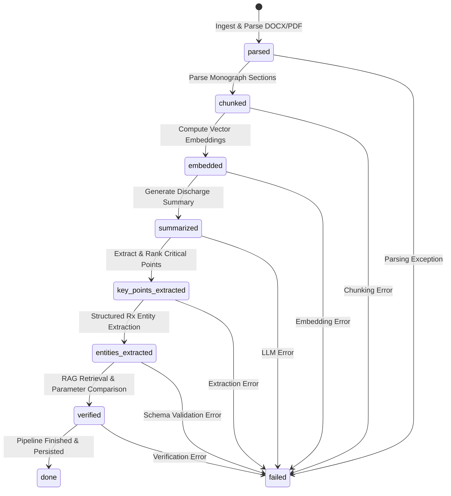
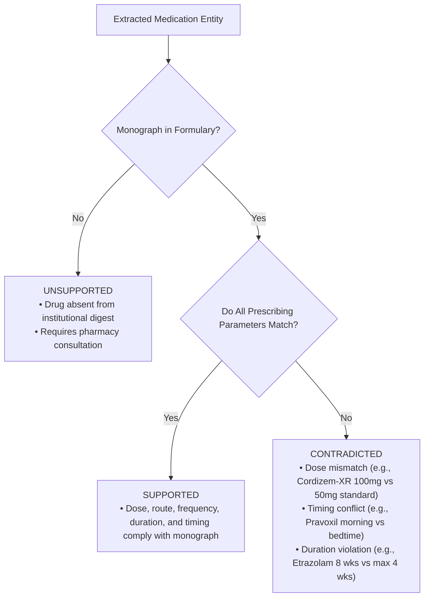

# Technical Architecture Specification

**Project**: Institutional Clinical Document Verification Agent  
**Revision**: 1.0.0  
**Stack**: FastAPI (Python 3.13) + React / Vite (TypeScript) + PostgreSQL with pgvector  

---

## 1. System Overview and Topology

The Document Verification System is structured around an asynchronous, event-driven decoupled architecture. It separates immediate HTTP client request termination from compute-intensive clinical document parsing, domain chunking, vector embedding generation, LLM-based summarization, structured prescription entity extraction, and RAG-grounded parameter verification.

```mermaid
graph TD
    Client["Client Browser (React + TypeScript + Tailwind)"]
    
    subgraph "API Gateway & Application Layer (FastAPI)"
        Auth["Auth Controller (JWT / bcrypt)"]
        Docs["Document Controller (Atomic Ingest & Hash Dedup)"]
        SSE["Telemetry Controller (SSE / WebSocket)"]
        VerifyAPI["Verification & View Controller"]
        PipelineWorker["Async Pipeline Engine (Background Orchestrator)"]
    end

    subgraph "AI & RAG Services"
        Parser["Document Parser (DOCX/PDF)"]
        Chunker["Monograph-Aware Chunker"]
        Embedder["Embedding Engine (pgvector / Gemini / OpenAI / Local)"]
        LLM["Clinical Reasoning & Extraction Engine"]
        RuleEngine["Prescribing Parameter Comparator"]
    end

    subgraph "Persistence Layer (PostgreSQL + pgvector)"
        UsersTable[("users")]
        DocsTable[("documents")]
        JobsTable[("jobs & job_stages")]
        ChunksTable[("formulary_chunks (pgvector)")]
        EntitiesTable[("prescribed_entities")]
        VerificationTable[("verification_results")]
        SummariesTable[("document_summaries & critical_points")]
    end

    Client -->|HTTP POST /auth/login| Auth
    Client -->|HTTP POST /api/documents/upload| Docs
    Client -->|HTTP GET /api/jobs/:id/events (SSE)| SSE
    Client -->|HTTP GET /api/documents/:id/analysis| VerifyAPI

    Docs -->|Atomic Transaction| DocsTable
    Docs -->|Spawn Task| PipelineWorker
    Docs -->|Check SHA-256 Window| DocsTable

    PipelineWorker --> Parser
    PipelineWorker --> Chunker
    PipelineWorker --> Embedder
    PipelineWorker --> LLM
    PipelineWorker --> RuleEngine

    Chunker --> ChunksTable
    Embedder --> ChunksTable
    PipelineWorker --> JobsTable
    PipelineWorker --> EntitiesTable
    PipelineWorker --> VerificationTable
    PipelineWorker --> SummariesTable

    SSE -.->|Stream State Updates| Client
```

---

## 2. Component Responsibilities

### 2.1 Frontend (React + TypeScript + TailwindCSS)
- **Authentication**: JWT token management, automatic auth header injection, login/signup forms, reviewer seed shortcut.
- **Upload Manager**: Drag-and-drop file ingestion, file type validation (`.docx`, `.pdf`), reference formulary selection, instant feedback.
- **Pipeline Live Visualizer**: Real-time stage stepper with active durations, stage icons, timestamps, error surfacing, and automatic resume upon page refresh.
- **Dual-Pane Document Workbench**:
  - **Left Pane (Primary Document)**: Formatted clinical viewer rendering the original discharge summary with section tabs, patient header, medication tables, and counseling warnings.
  - **Right Pane (Analysis Tabs)**:
    - *Executive Summary*: Clinical narrative overview.
    - *Critical Action Points*: Ranked patient warnings with category badges and text quotes.
    - *Flagged Issues & Verification*: Filterable medication cards showing verification status (`Supported`, `Contradicted`, `Unsupported`), prescribing parameter comparison tables, and citation drawer triggers.
    - *Reference Formulary Inspector*: Full rendered formulary digest with instant search and automated jump-to-section deep linking from citations.

### 2.2 Backend (FastAPI + AsyncIO + SQLAlchemy)
- **Asynchronous Execution Model**: The `/api/documents/upload` endpoint performs file validation, computes the SHA-256 hash for deduplication, writes document and job rows inside an atomic transaction, returns HTTP 202 Accepted with a `job_id` in < 150ms, and enqueues the pipeline via `asyncio.create_task`.
- **Real-Time Telemetry Dispatcher**: An in-memory and database-backed event broker publishes stage progress events. Clients listening on `/api/jobs/{id}/events` (SSE) or `/api/jobs/{id}/ws` receive instant updates without polling.
- **Transactional Consistency**: Database operations during document creation use transactional commit/rollback. Any failure during document registration cleanly aborts without leaving orphaned files or unlinked job records.
- **Tenant Isolation**: All database queries are filtered by `user_id` derived from the validated JWT token. Cross-tenant access attempts immediately yield HTTP 403 / 404.

---

## 3. Asynchronous Pipeline & Granular Stages

The pipeline transitions sequentially through seven observable stages:



### Stage Details:
1. `parsed`:
   - Extracts structured sections from the primary discharge summary (Patient demographics, Reason for Admission, Hospital Course, Discharge Diagnoses, Discharge Medications, Counseling Warnings, Follow-up).
2. `chunked`:
   - Segments the institutional reference formulary into discrete monograph units (e.g., *Section I. Cardiovascular Agents — Velantine*, *Section II. Lipid-Lowering Agents — Pravoxil*).
   - Preserves section hierarchy, Roman numerals, standard doses, maximum doses, and contraindications.
3. `embedded`:
   - Computes dense vector representations for each monograph chunk.
   - Stores chunk embeddings with metadata in PostgreSQL with pgvector (using cosine distance index `ivfflat` / `hnsw`).
4. `summarized`:
   - Generates a concise, faithful clinical executive summary synthesized from the primary document's admission history and hospital course.
5. `key_points_extracted`:
   - Extracts explicit patient warnings from Section 5 and Section 6 of the primary document.
   - Ranks points by criticality (High: urgent side effects, abrupt cessation dangers; Medium: administration timing and duration limits; Low: routine follow-up scheduling).
6. `entities_extracted`:
   - Extracts structured prescription entities (`MedicationEntity`) matching: drug name, dose, unit, route, frequency, duration, indication, source section, and notes.
7. `verified`:
   - For each extracted medication:
     - Retrieves the top relevant reference monograph from pgvector.
     - Performs grounded parameter verification: standard dose vs. prescribed dose, administration timing (e.g., morning vs. bedtime), duration limits, and formulary inclusion.
     - Classifies status as **Supported**, **Contradicted**, or **Unsupported**.
     - Generates grounded citation linking to the specific formulary section, monograph, and verbatim passage.
8. `done`:
   - Final status timestamped, complete analysis bundle cached for fast sub-millisecond retrieval.

---

## 4. Medical Knowledge Integration & Verification Logic

### 4.1 Verification State Modeling
The system models prescribing verification across three explicit states:



### 4.2 Known Test Cases & Ground Truth Grounding

| Prescribed Drug | Prescribed Regimen | Formulary Monograph Ground Truth | System Verification Outcome | Specific Citation |
| :--- | :--- | :--- | :--- | :--- |
| **Velantine** | 10 mg PO once daily, indefinitely (Hypertension) | Section I: 10 mg PO once daily. First-line antihypertensive. Max 40 mg. | **Supported** | Section I. Cardiovascular Agents — Velantine |
| **Cordizem-XR** | 100 mg PO once daily, indefinitely (Rate control) | Section I: Standard adult dose 50 mg PO daily, morning. Titrate by 25 mg every 2+ weeks. Max 200 mg. | **Contradicted** (Starting dose 100 mg exceeds standard initial adult dose of 50 mg) | Section I. Cardiovascular Agents — Cordizem-XR |
| **Pravoxil** | 20 mg PO every morning, indefinitely (Hyperlipidemia) | Section II: Standard adult dose 20 mg PO daily *at bedtime*. "Morning administration substantially reduces therapeutic effect." | **Contradicted** (Chronopharmacological timing violation: prescribed morning instead of mandatory bedtime) | Section II. Lipid-Lowering Agents — Pravoxil |
| **Etrazolam** | 0.5 mg PO twice daily for 8 weeks (Acute anxiety) | Section III: 0.5 mg PO twice daily. "Approved for short-term use only... duration of up to 4 weeks... Prescribers must not initiate Etrazolam with an intended duration beyond 4 weeks." | **Contradicted** (Duration limit violation: 8 weeks exceeds maximum permitted 4-week course) | Section III. Anxiolytics and Sedatives — Etrazolam |
| **Pranixol** | 10 mg PO once daily, indefinitely (Adjunctive CV protection) | Not listed in formulary digest. Monograph absent. | **Unsupported** (Medication not included in formulary digest) | Explicit note: No supporting monograph found in formulary |
| **Quintaxin** | 20 mg PO once daily before breakfast, 8 weeks reassess (GERD) | Section V: 20 mg PO once daily, 30 min before breakfast. Review indication at 8 weeks. | **Supported** | Section V. Gastrointestinal Agents — Quintaxin |

---

## 5. RAG & Vector Retrieval Strategy

### 5.1 Chunking Strategy
Instead of arbitrary token window slicing (e.g. 500 characters with 50-character overlap), which fragments drug monographs across chunk boundaries and separates contraindications from dosages, the system uses a **Monograph-Aware Chunker**:
- Preserves the semantic integrity of each drug entry as a self-contained retrieval unit.
- Prepends chunk metadata with hierarchical context: `[Digest Revision 8.2] > [Section {Roman} {Title}] > [Monograph: {Drug Name}]`.
- Ensures parameter extraction and retrieval relevance maintain 100% precision without chunk clipping.

### 5.2 Embedding & Vector Store
- Vector representation: 768 / 1536 dimensional dense vectors (compatible with Google Vertex/Gemini `text-embedding-004`, OpenAI `text-embedding-3-small`, and local fallback embeddings).
- Stored directly in PostgreSQL utilizing the `pgvector` extension with vector cosine distance index (`<=>`).
- Hybrid Search: Queries combine dense vector similarity with exact drug name metadata filters to ensure zero retrieval misses for known formulary drugs.

---

## 6. Duplicate Detection Architecture (Extra Credit)

To prevent redundant processing and unnecessary LLM API costs, the ingestion pipeline implements content-hash deduplication:
1. Upon upload, the backend computes the `SHA-256` digest of the primary document binary.
2. The system queries the `documents` table for identical hashes uploaded by the same `user_id` within the configurable `DUPLICATE_WINDOW_MINUTES` (default: 5 minutes).
3. If an existing job is found, the system skips ingestion and immediately returns the existing `job_id`, preserving server resources and presenting the completed analysis immediately.

---

## 7. Deep-Linking Reference Viewer Architecture (Extra Credit)

Flagged issue citations include precise anchor identifiers (e.g., `monograph-pravoxil`, `section-ii-lipid-lowering-agents`).
- Clicking the "View in Reference" action on a flagged card triggers an event across the dual-pane workbench.
- The reference viewer automatically switches to the reference document view, smooth-scrolls to the target monograph section, and triggers a visual highlight pulse on the exact cited sentence.
