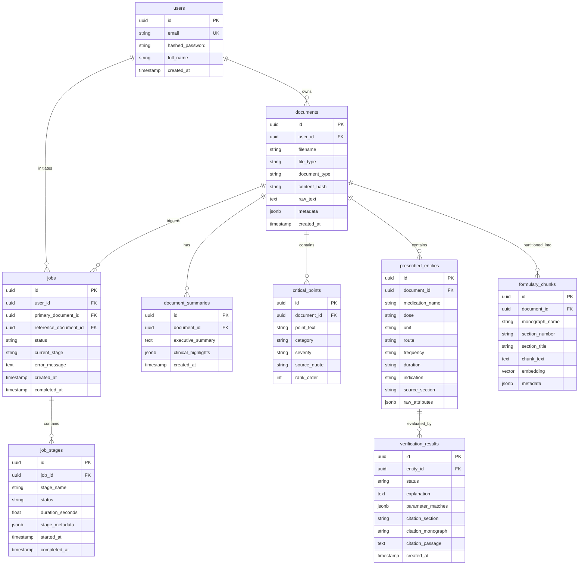

# Database Design & Schema Specification

**Database Engine**: PostgreSQL 16+ with `pgvector` extension  
**ORM / Data Access**: SQLAlchemy 2.0 (Async) + `asyncpg`  
**Migration Tool**: Alembic (versioned migrations)  

---

## 1. Entity-Relationship Diagram (ERD)

---

## 2. Table Specifications & Constraints

### 2.1 `users`
Represents application users (clinical reviewers).
- `id` (UUID, Primary Key, default `gen_random_uuid()`)
- `email` (VARCHAR(255), Unique, Indexed, NOT NULL)
- `hashed_password` (VARCHAR(255), NOT NULL)
- `full_name` (VARCHAR(255), NOT NULL)
- `created_at` (TIMESTAMPTZ, default `NOW()`)

### 2.2 `documents`
Represents uploaded primary discharge summaries or reference formulary digests.
- `id` (UUID, Primary Key)
- `user_id` (UUID, Foreign Key → `users.id`, ON DELETE CASCADE, Indexed)
- `filename` (VARCHAR(255), NOT NULL)
- `file_type` (VARCHAR(50), NOT NULL: `'docx'`, `'pdf'`)
- `document_type` (VARCHAR(50), NOT NULL: `'primary'`, `'reference'`)
- `content_hash` (VARCHAR(64), Indexed, NOT NULL) — SHA-256 hash for deduplication.
- `raw_text` (TEXT, NOT NULL) — Extracted document content.
- `metadata` (JSONB, default `'{}'`) — Document sections, author, dictation date.
- `created_at` (TIMESTAMPTZ, default `NOW()`)

*Indexes*:
- `idx_documents_user_hash_created` (`user_id`, `content_hash`, `created_at DESC`)

### 2.3 `jobs`
Represents asynchronous pipeline execution runs.
- `id` (UUID, Primary Key)
- `user_id` (UUID, Foreign Key → `users.id`, ON DELETE CASCADE, Indexed)
- `primary_document_id` (UUID, Foreign Key → `documents.id`, NOT NULL)
- `reference_document_id` (UUID, Foreign Key → `documents.id`, NOT NULL)
- `status` (VARCHAR(50), NOT NULL: `'pending'`, `'processing'`, `'completed'`, `'failed'`)
- `current_stage` (VARCHAR(50), NOT NULL: `'parsed'`, `'chunked'`, `'embedded'`, `'summarized'`, `'key_points_extracted'`, `'entities_extracted'`, `'verified'`, `'done'`)
- `error_message` (TEXT, NULL)
- `created_at` (TIMESTAMPTZ, default `NOW()`)
- `completed_at` (TIMESTAMPTZ, NULL)

### 2.4 `job_stages`
Granular telemetry log for each named pipeline stage.
- `id` (UUID, Primary Key)
- `job_id` (UUID, Foreign Key → `jobs.id`, ON DELETE CASCADE, Indexed)
- `stage_name` (VARCHAR(50), NOT NULL)
- `status` (VARCHAR(50), NOT NULL: `'pending'`, `'in_progress'`, `'completed'`, `'failed'`)
- `duration_seconds` (FLOAT, default 0.0)
- `stage_metadata` (JSONB, default `'{}'`)
- `started_at` (TIMESTAMPTZ, default `NOW()`)
- `completed_at` (TIMESTAMPTZ, NULL)

### 2.5 `formulary_chunks`
Stores discrete reference monographs with pgvector embeddings for RAG retrieval.
- `id` (UUID, Primary Key)
- `document_id` (UUID, Foreign Key → `documents.id`, ON DELETE CASCADE, Indexed)
- `monograph_name` (VARCHAR(255), Indexed, NOT NULL) — e.g. `'Velantine'`, `'Pravoxil'`
- `section_number` (VARCHAR(50), NOT NULL) — e.g. `'I'`, `'II'`
- `section_title` (VARCHAR(255), NOT NULL) — e.g. `'Cardiovascular Agents'`
- `chunk_text` (TEXT, NOT NULL) — Complete monograph text.
- `embedding` (VECTOR(768) or VECTOR(1536)) — Dense semantic vector.
- `metadata` (JSONB, default `'{}'`)

### 2.6 `prescribed_entities`
Structured medications extracted from the primary discharge summary.
- `id` (UUID, Primary Key)
- `document_id` (UUID, Foreign Key → `documents.id`, ON DELETE CASCADE, Indexed)
- `medication_name` (VARCHAR(255), NOT NULL)
- `dose` (VARCHAR(100), NOT NULL)
- `unit` (VARCHAR(50), NOT NULL)
- `route` (VARCHAR(50), NOT NULL)
- `frequency` (VARCHAR(100), NOT NULL)
- `duration` (VARCHAR(100), NOT NULL)
- `indication` (VARCHAR(255), NOT NULL)
- `source_section` (VARCHAR(255), NOT NULL)
- `raw_attributes` (JSONB, default `'{}'`)

### 2.7 `verification_results`
Grounded clinical verification evaluation for each extracted prescription.
- `id` (UUID, Primary Key)
- `entity_id` (UUID, Foreign Key → `prescribed_entities.id`, ON DELETE CASCADE, Unique)
- `status` (VARCHAR(50), NOT NULL: `'Supported'`, `'Contradicted'`, `'Unsupported'`)
- `explanation` (TEXT, NOT NULL)
- `parameter_matches` (JSONB, NOT NULL) — Detailed boolean breakdown for dose, timing, duration, etc.
- `citation_section` (VARCHAR(255), NULL)
- `citation_monograph` (VARCHAR(255), NULL)
- `citation_passage` (TEXT, NULL)
- `created_at` (TIMESTAMPTZ, default `NOW()`)

### 2.8 `document_summaries` & `critical_points`
Stores generated clinical summaries and patient warning items.
- Summaries store executive overview and clinical status.
- Critical points store categorized points (`'timing_critical'`, `'duration_limit'`, `'urgent_adverse_effect'`, `'abrupt_discontinuation_warning'`, `'follow_up_lab'`) and severity rank.

---

## 3. Database Transactions & Atomicity

In compliance with assignment requirement §3.3:
> "When a user uploads a document, all records created as part of that upload must be written atomically. A partial write... must not be possible. If any part of the creation fails, the system must roll back to a clean state."

The ingestion pipeline encapsulates the following in a single SQLAlchemy async transaction (`async with session.begin():`):
1. Document record insertion (`documents` row for primary document).
2. Document record check/insertion for selected reference formulary.
3. Job record initialization (`jobs` row with initial status `'pending'`).
4. Pre-populating the 7 granular `job_stages` rows with status `'pending'`.

If any step raises an exception (e.g., storage I/O failure, validation error, database constraint violation), the transaction is rolled back immediately; no orphaned documents, jobs, or stages persist in the database.
